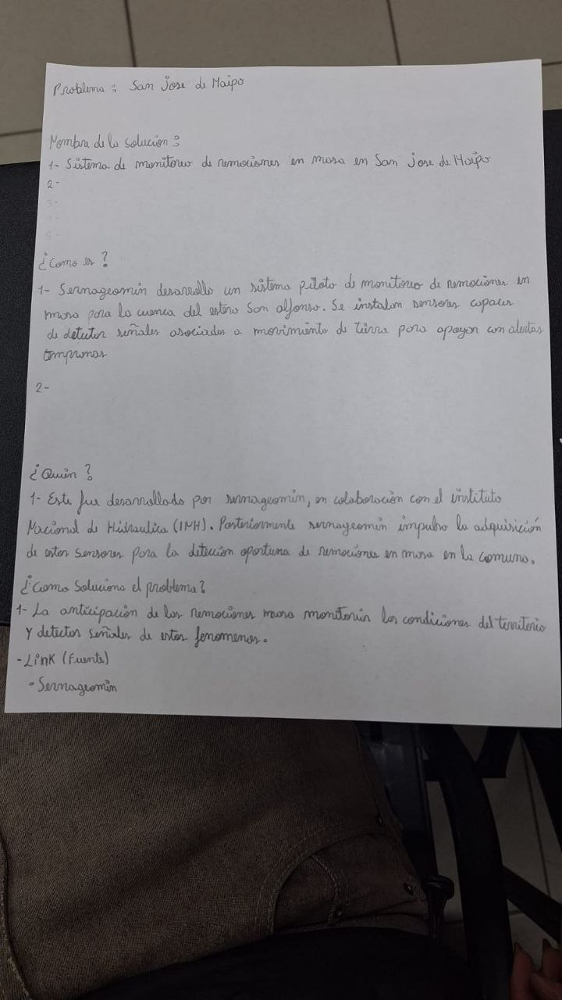
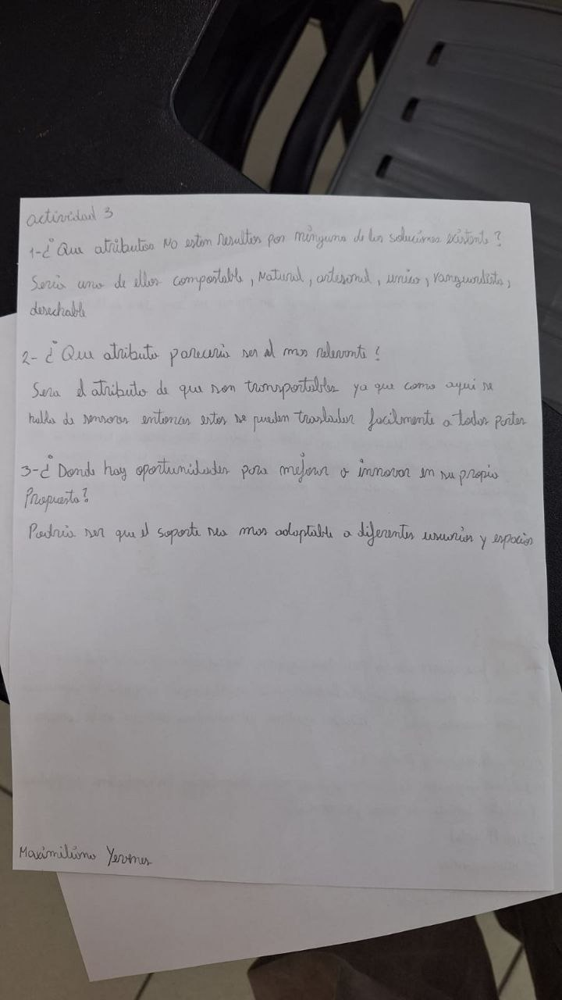
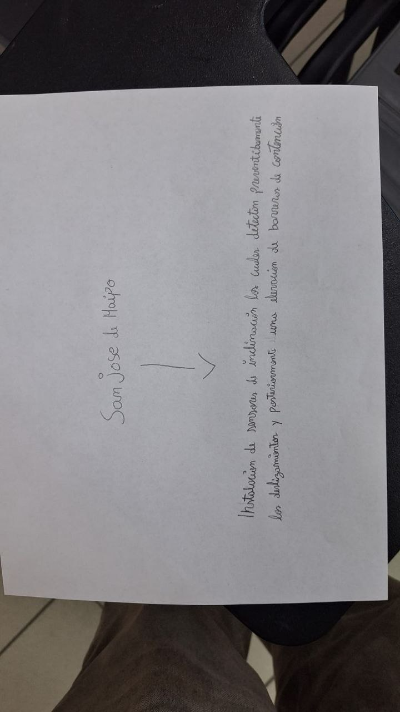

<!--
CÓMO USAR: reemplaza cada *(completar)* con tu contenido.
Las guías en comentarios HTML no se ven en GitHub (puedes borrarlas al terminar).
Editar con: nano bitacora/S03.md
-->

# S03 — Estado del arte, benchmark y conexión con el desafío

**Fecha:** 22-09-2026

**Participantes:** Juan Burgos, Juan Alvarez, Maximiliano Yévenes, Emilia Marchant, Camila Rivera

**Lugar o modalidad:** *(completar)*

**Tipo de sesión:** Clase 06 — Estado del arte, benchmark y atributos vs soluciones

## Objetivo de la sesión

Comprender que las propuestas conceptuales permiten perfilar soluciones innovadoras con atributos deseables por el usuario, y aprender a analizar las soluciones existentes mediante la búsqueda del estado del arte y el benchmarking para innovar.

## 1. Comentarios de la entrega anterior (S02)

- Feedback general de la profesora: *(completar)*
- Feedback específico a nuestro equipo: *(completar)*
- **Compromiso de mejora:** *(completar)*

## 2. Actividad 1 — Análisis del estado del arte

**Consigna:** buscar en internet las soluciones que ya existen del problema (o similar/parcial), listar las soluciones con sus links y responder por cada una: nombre de la solución, cómo es, quién la está usando o quién la hizo, y cómo soluciona el problema. La clase pide subir **mínimo 5 soluciones existentes con links** (PDF digital) a la bitácora.

<!-- Estado actual del equipo: 1 de 5 soluciones. Duplicar el bloque de "Solución" hasta completar el mínimo. -->

### Solución 1 — Sistema de monitoreo de remociones en masa en San José de Maipo

| Campo | Respuesta |
|---|---|
| Problema | San José de Maipo |
| Nombre de la solución | Sistema de monitoreo de remociones en masa en San José de Maipo |
| ¿Cómo es? (descripción breve) | Sernageomin desarrolló un sistema piloto de monitoreo de remociones en masa para la cuenca del estero San Alfonso. Se instalan sensores capaces de detectar señales asociadas a movimientos de tierra para apoyar con alertas tempranas. |
| ¿Quién la está usando? o ¿quién la hizo? | Fue desarrollada por Sernageomin, en colaboración con el Instituto Nacional de Hidráulica (INH). Posteriormente Sernageomin impulsó la adquisición de estos sensores para la detección oportuna de remociones en masa en la comuna. |
| ¿Cómo soluciona el problema? | Anticipa las remociones en masa: monitoriza las condiciones del territorio y detecta señales de estos fenómenos. |
| Link fuente | Sernageomin *(agregar link)* |

<!-- Soluciones 2 a 5: pendientes de completar. -->

## 3. Actividad 2 — Matriz de atributos vs soluciones

**Consigna:** determinar entre 3 y 5 atributos relevantes para evaluar las soluciones y completar la matriz comparando las soluciones existentes del estado del arte.

| Atributos | Solución existente 1 | Solución existente 2 | Solución existente 3 |
|---|---|---|---|
| *(completar atributo 1)* | *(completar)* | *(completar)* | *(completar)* |
| *(completar atributo 2)* | *(completar)* | *(completar)* | *(completar)* |
| *(completar atributo 3)* | *(completar)* | *(completar)* | *(completar)* |

<!-- Atributos ya mencionados por el equipo en la Actividad 3: compostable, natural, artesanal, único, vanguardista, desechable y transportable. -->

## 4. Actividad 3 — Atributos y oportunidades

Respuestas del equipo al análisis comparativo:

1. **¿Qué atributos NO están resueltos por ninguna de las soluciones existentes?**
   Algunos de ellos: compostable, natural, artesanal, único, vanguardista y desechable.
2. **¿Qué atributo parecería ser el más relevante?**
   Sería el atributo de que son transportables, ya que como aquí no hay dos sensores, entonces estos se pueden trasladar fácilmente a todas partes.
3. **¿Dónde hay oportunidades para mejorar o innovar en su propio propósito?**
   Podría ser que el soporte sea más adaptable a diferentes usuarios y espacios.

## 5. Actividad 4 — Lluvia de ideas 2: propuestas

**Consigna:** hacer una segunda lluvia de ideas de posibles soluciones, ahora con el análisis de estado del arte y benchmark.

**Idea inicial registrada en la sesión (hoja «San José de Maipo»):** instalación de sensores de inclinación que detectan preventivamente los deslizamientos y, posteriormente, una disposición de barreras de contención.

- **Propuesta 1:** *(completar — diseño conceptual, costo y componentes)*
- **Propuesta 2:** *(completar — diseño conceptual, costo y componentes)*
- **Propuesta 3:** *(completar — diseño conceptual, costo y componentes)*

<!-- Indicación de la profesora: avanzar fuera de clase; se presentan tres soluciones propuestas, cada una con diseño conceptual, costo y componentes. -->

## 6. Fotos de la sesión

*Actividad 1: análisis de una solución existente — sistema piloto de monitoreo de remociones en masa de SERNAGEOMIN (cuenca del estero San Alfonso).*

*Actividad 3: atributos no resueltos por las soluciones existentes, atributo más relevante (transportabilidad) y oportunidad de mejora (soporte adaptable).*

*Hoja «San José de Maipo»: idea de instalar sensores de inclinación que detectan preventivamente los deslizamientos y, posteriormente, barreras de contención.*

## 7. Síntesis del equipo

*(completar — qué se repite entre las soluciones analizadas, qué nos llamó la atención y conclusiones del equipo)*

## 8. Conexión con el proyecto Capstone

- **Qué confirma o cambia este análisis en nuestro desafío:** *(completar)*
- **Oportunidades detectadas para nuestro concepto:** *(completar — la Actividad 3 ya apunta a un soporte adaptable a distintos usuarios y espacios)*
- **Preguntas «¿Cómo podríamos…?» que nos surgen:** *(completar)*

## 9. Conceptos clave de la clase

- **Estado del arte:** análisis de investigaciones, tecnologías, métodos y resultados existentes en un área particular («el arte»), para comprender el progreso y las limitaciones actuales.
- **Benchmark:** comparación de procesos, prácticas o desempeño entre organizaciones y/o proyectos, para identificar mejores prácticas, fijar objetivos de rendimiento y generar mejoras.
- **Matriz de atributos vs soluciones:** herramienta para analizar y comparar atributos de las mejores soluciones existentes; permite entender cómo otros abordan el mismo problema, identificar enfoques adaptables y fundamentar mejores decisiones.
- **Atributos conceptuales:** cualidades que orientan la propuesta (plegable, adaptable, compostable, transportable, modular, resistente, único, artesanal, deseable, etc.). La innovación está en detectar atributos que las soluciones existentes no cubren.

## 10. Decisiones y próximos pasos

| Decisión / tarea | Responsable | Fecha límite | Estado |
|---|---|---|---|
| Completar en la bitácora el mínimo de 5 soluciones existentes con links (Actividad 1) | Equipo | Próxima clase | Pendiente |
| Definir 3–5 atributos clave y completar la matriz de atributos vs soluciones (Actividad 2) | Equipo | Próxima clase | Pendiente |
| Avanzar en las 3 soluciones propuestas, cada una con diseño conceptual, costo y componentes | Equipo | Próxima semana | Pendiente |
| Preparar el pitch de cierre de la Unidad 2 | Equipo | Próxima semana | Pendiente |

## 11. Reflexión breve

- **Qué fue fácil:** *(completar)*
- **Qué fue difícil:** *(completar)*
- **Qué necesitamos resolver:** *(completar)*

<!-- Indicación de la profesora: la próxima semana se presentan las 3 propuestas y se cierra la Unidad 2 con propuestas estilo pitch. -->
